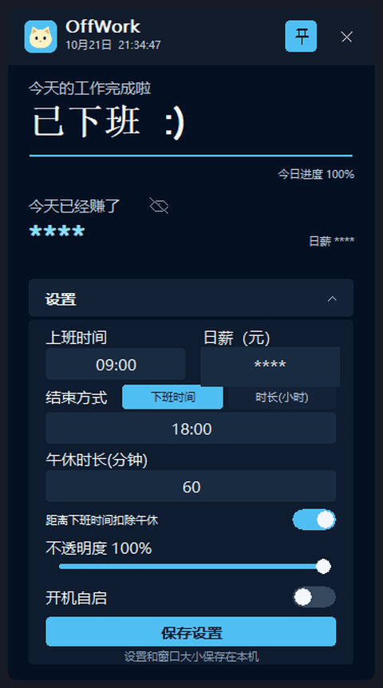

# OffWork 🐱

一只陪你等下班的 Windows 原生悬浮窗。

填写上下班时间和日薪后，OffWork 会实时显示距离下班还有多久、今天的工作进度，以及此刻已经赚到的金额。它不需要安装运行时、不需要登录；截图识别在本机完成，联网仅用于检查和下载更新。

## 下载

前往 [Releases](https://github.com/alertform/OffWork/releases/latest)，两种方式任选其一。支持 Windows 10 和 Windows 11 的 x64 版本。

| | `OffWork-Setup.exe`（安装版） | `OffWork.exe`（免安装版） |
|---|---|---|
| 安装目录 | 可自选，默认装到当前用户目录 | 放哪就在哪运行 |
| 开始菜单快捷方式 | ✅ | ❌ |
| 桌面快捷方式 | 可选 | ❌ |
| 开机自启 | 安装时可勾选，装好后也能在应用里改 | 应用里可随时开关 |
| 卸载入口 | 出现在「应用和功能」里 | 直接删掉 exe 即可 |
| 管理员权限 | 不需要 | 不需要 |

两种方式装出来的是同一个程序，功能没有差别。

## 安装版

运行 `OffWork-Setup.exe`，向导有两页需要你做选择：

1. **选择安装位置**。默认是 `%LOCALAPPDATA%\Programs\OffWork`，也就是当前用户自己的目录，所以**全程不需要管理员权限，不会弹 UAC**。想装到别处，点「浏览」换一个目录即可。
2. **选择附加任务**：
   - **创建桌面快捷方式** —— 默认不勾。
   - **开机自启（登录时自动运行 OffWork）** —— 默认不勾。
   - 装完那一页还有 **安装完成后运行 OffWork**。

开始菜单快捷方式总是会创建。

### 开机自启怎么改

装好之后随时可以改，不用重装：**展开「设置」→ 切换「开机自启」开关**。

这个开关读写的就是 Windows 真正的启动项：

```text
HKCU\Software\Microsoft\Windows\CurrentVersion\Run  ->  值名 OffWork
```

值里存的是带引号的完整 exe 路径，所以装在带空格的目录里也能正常启动。**注册表是唯一真相**，应用不会另存一份开关状态在配置文件里；也就是说你在别处（比如任务管理器的「启动」页）改了它，OffWork 下次展开设置时显示的就是改过之后的状态。

免安装版同样支持这个开关，注册的是**当前这个 exe 自己的路径**。如果你先用安装版开了自启，之后又去跑某个免安装副本并再次开启，启动项会指向后者。

### 卸载

在「设置 → 应用 → 已安装的应用」里找到 OffWork 卸载，或者运行安装目录下的 `unins000.exe`。卸载会移除：

- 安装的程序文件和安装目录
- 开始菜单快捷方式，以及安装时创建的桌面快捷方式
- 「应用和功能」里的卸载入口
- `OffWork` 这一项开机自启注册表值（无论它是安装时勾的，还是你后来在应用里开的）

**卸载不会删除你的设置。** `%LOCALAPPDATA%\OffWork\settings.ini` 会保留，重新安装后上下班时间、日薪、窗口大小和不透明度都还在。想彻底清干净就手动删掉这个文件。

## 免安装版

直接双击 `OffWork.exe` 就能用，不写快捷方式、不注册卸载入口。设置仍然保存在 `%LOCALAPPDATA%\OffWork\settings.ini`（和安装版共用同一份），删掉 exe 就算卸载完成 —— 但如果你在免安装版里开过「开机自启」，记得先把开关关掉，否则那条注册表值会指向一个已经不存在的文件。

## 使用方法

1. 运行 OffWork，悬浮窗会出现在屏幕右上角。
2. 展开「设置」，以 `HH:MM` 格式填写上班和下班时间，再填写日薪。
   - 也可以把「结束方式」切换到「时长（小时）」，填写 `8`、`8.5` 或 `9`，下班时间会根据上班时间自动计算；跨过午夜也支持。
3. 点「保存设置」，倒计时和已赚金额会立即更新并自动收起设置。
4. 点标题栏图钉，可以开启或取消窗口置顶。
5. 拖动窗口边缘或四角可以等比例调整大小；设置里可以调不透明度和开机自启。
6. 点关闭按钮会把窗口隐藏到系统托盘。双击托盘小猫恢复窗口；右键菜单可以显示/隐藏窗口、切换开机自启或彻底退出。
7. 距离实际下班首次降至五分钟时，会收到「距离下班还有五分钟」提醒；到达下班时间时，会收到「可以下班啦」提醒。点击通知可以恢复窗口，每种提醒每班次各一次。
8. 把一张 PNG、JPG/JPEG 或 BMP 打卡截图拖到主窗口任意位置。平时没有拖放提示或固定投放区；仅在有效图片拖入时，整窗切换为淡青色背景、内缩圆角虚线框和居中图片图标，离开或放下后恢复。识别成功后静默填写上班时间并保存，不显示弹窗、通知或文字横幅，也不发声；时长模式会保留包含午休的班次总跨度并重算下班时间。失败时仅用短暂、静音的中文托盘气泡提示。

### 金额隐藏与自动更新（0.4.0）

点击「今天已经赚了」旁的小眼睛，可以在金额和 `****` 之间切换；隐藏时显示划线眼睛，编辑表单外的所有金额（包括已赚金额和日薪）都会隐藏。设置中的日薪输入框仍显示可编辑的数值。状态自动保存为 `settings.ini` 的 `[window] hideEarned=1`，旧配置默认显示金额。

启动时及之后每六小时，后台通过 WinHTTP 访问 [GitHub 最新 Release API](https://api.github.com/repos/alertform/OffWork/releases/latest)，不使用令牌。只有发现比当前版本新的正式版本、且存在 `OffWork-Setup.exe` 安装包时，标题栏才显示小型下载图标和圆点。检查、下载或启动安装程序失败均静默处理；下载失败可再次点击图标重试。

点击图标会把安装包下载到 `%TEMP%\OffWork-update-{GUID}\OffWork-Setup.exe`，下载期间图标显示细进度环；服务器未提供文件大小时显示不定进度环。版本检查、下载和文件写入均在后台线程执行，完成与进度仅通过 `PostMessage` 的 `WM_APP` 消息通知界面。窗口销毁时先取消任务并同步关闭消息接收入口，不等待网络请求；后台线程独立持有数据并清理未完成文件。标题栏关闭仍按原有规则隐藏到托盘。下载完成后启动 `/VERYSILENT /SUPPRESSMSGBOXES /NORESTART` 安装，应用退出以便替换文件，安装完成后自动重新启动。安装保留 `%LOCALAPPDATA%\OffWork\settings.ini` 及现有开机自启状态。免安装版使用同一更新入口，更新后运行安装版，沿用同一份本地设置。离线不影响倒计时和截图识别。

如截图仍在识别，会先等识别结束再启动安装；下载失败会清理临时文件，成功使用的安装包超过一天后会在后续更新检查中清理。

### 午休与倒计时

展开设置，填写「午休时长(分钟)」，例如 `60`；留空或 `0` 表示不设午休。只接受整数分钟（`0`–`1439`）。「距离下班时间扣除午休」开关只在时长大于 `0` 时生效。

开启后，有效工时为「上班到下班的跨度 − 午休时长」。两种输入模式下，开关均不改变下班时刻或倒计时；时长模式中的小时数表示包含午休的班次总跨度，例如 09:00 上班、时长 `8` 小时、午休 `60` 分钟，下班时间仍为 17:00，有效工时为 7 小时。切换输入模式、重新打开设置和截图更新上班时间时均保留这个总跨度。支持跨午夜班次。有效工时必须大于零，班次跨度必须小于 24 小时。关闭开关则忽略午休，按连续时长计算。

计算模型不指定午休发生在哪个时间段：倒计时始终为距离实际下班的时间；进度为 `clamp((有效工时 − 剩余时间) / 有效工时, 0, 1)`，金额为日薪乘进度。等价于从班次开头扣除这段时长，而非在中午暂停。例如 09:00–18:00、午休 60 分钟，09:00–10:00 进度为零，12:00 为 25%，14:00 为 50%，18:00 为 100%。五分钟提醒对应实际下班前五分钟，不会因扣除午休提前一小时。

设置保存在 `%LOCALAPPDATA%\OffWork\settings.ini` 的 `[work]` 中：`lunchDurationMinutes` 为分钟数，`deductLunch=1` 表示扣除。缺少新时长键时，加载会将有效的旧 `lunchStartMinutes`、`lunchEndMinutes` 转为时长（跨午夜则向次日计算），保持已保存的上下班时刻不变；下一次保存只写入新时长并移除两个旧键。新键存在时优先使用，空值、无效值或 `0` 不会恢复旧午休；无有效午休或午休不小于班次跨度时，加载会关闭扣除。没有午休设置的旧配置默认不设午休。

### 截图识别与提醒

截图识别使用本机 Windows.Media.Ocr，优先简体中文，不上传图片、不依赖第三方 OCR。请在 Windows 语言设置中安装简体中文的文字识别（OCR）组件。识别优先选取「上班打卡」「打卡成功」附近的时间，忽略「班次时间」「班次」「应上班」对应的排班时间；没有关键词匹配时才从其他有效时间中取最早值。支持 `08:55`、`08：55`、`08 : 55` 等形式。成功导入会替换当前上班时间和设置面板内容。

下面演示拖入打卡截图时的悬停样式，以及识别后上班时间从 `09:00` 自动填为 `08:55`。演示已开启金额隐藏，日薪编辑框也作了隐私遮挡。



拖放使用 OLE `IDropTarget`，只接收 `CF_HDROP` 中的一张受支持图片（扩展名不区分大小写）；多文件、目录、不支持的格式和非文件数据均拒绝，不触发视觉变化。临时拖入样式沿用主题配色和 GDI 绘制，通过同一 `UpdateLayeredWindow` 分层表面提交，支持展开/收起、缩放、DPI 与不透明度设置。失败气泡约 4 秒后撤下；是否显示仍由 Windows 通知设置决定。

两种提醒在窗口隐藏到托盘时仍有效。启动时已经处于五分钟窗口内或已下班，不补发提醒；修改排班或通过 OCR 导入时间会重置提醒基线。长时间休眠后观察到的过期变化会静默处理，避免补发旧提醒。

输入框支持光标移动、选中（拖选或双击全选）、`Tab` 切换、以及 `Ctrl+A/C/X/V`。时间框只接受数字和冒号，日薪和工作小时框接受数字和小数点，午休分钟框只接受数字。

应用采用单实例设计：再次运行 exe 会唤起已有窗口，不会叠出多个悬浮窗。

## 功能

- 每秒更新当前时间和下班倒计时
- 根据有效工作时长线性计算今日已赚金额
- 支持跨午夜班次
- 可填写下班时间，也可填写工作时长并自动计算下班时间
- 默认置顶，并可随时取消
- 75%–150% 等比例缩放并自动记住大小，**缩放过程逐帧一致，没有残影**
- 25%–100% 不透明度滑动调节，默认完全不透明
- 应用内「开机自启」开关，以注册表为准
- 常驻系统托盘，关闭窗口不丢失倒计时；托盘菜单可控制窗口、自启和退出
- 五分钟前和到达下班时间时分别发送一次 Windows 系统通知，隐藏到托盘时同样有效
- 午休设置与可选有效工时扣除，兼容旧配置
- 本机识别打卡截图，自动填入上班时间并保存
- 自动记住上下班时间和日薪
- 内嵌多尺寸小猫程序图标，Explorer 属性里有完整版本信息
- 单个原生 Win32 exe，无 .NET/WinUI/Electron 运行时

下班提醒遵循 Windows 的通知设置；开启「请勿打扰」或专注助手时，系统可能隐藏通知横幅。

### 关于缩放不留残影

窗口的尺寸、位置和像素由一次 `UpdateLayeredWindow` 一起提交，并且缩放拖拽由应用自己接管，不走系统的 sizing loop。这样被合成的每一帧，几何和内容天生就是配套的 —— 不存在「窗口已经变成新尺寸、内容还是旧的」那一帧。

## 金额计算

工作期间：

```text
已赚金额 = 日薪 × 已工作时长 ÷ 当日总工作时长
```

上班前显示 ¥0.00；下班后封顶为完整日薪。开启午休扣除后，总工作时长为班次跨度减午休分钟数，已工作时长为 `max(0, 总工作时长 − 距离下班的剩余时间)`，详见上面的午休计算模型。

## 开发与构建

项目使用 C++20、Win32 API、GDI 和 CMake。Release 使用静态 MSVC 运行时，因此最终交付只有一个 exe。

在 Visual Studio Developer PowerShell 中执行：

```powershell
cmake -S . -B build -A x64 -DCMAKE_MSVC_RUNTIME_LIBRARY=MultiThreaded
cmake --build build --config Release --parallel
ctest --test-dir build -C Release --output-on-failure
```

构建结果位于 `build\Release\OffWork.exe`。C++/WinRT 头文件及 `windowsapp.lib` 来自 Windows SDK，无需安装 OCR 包。

已有 Ninja Release 目录时，也可以在 Developer PowerShell 中执行：

```powershell
cmake -S . -B build/release-ninja -G Ninja -DCMAKE_BUILD_TYPE=Release
cmake --build build/release-ninja --parallel
ctest --test-dir build/release-ninja -C Release --output-on-failure
.\build\release-ninja\OffWorkOcrImageTests.exe tests\data\dingtalk_clockin.png
```

CTest 包含计算器、文本编辑、配置兼容、开机自启、两种提醒、OCR 纯文本解析、真实图片 OCR、受支持图片扩展名、OLE 拖放接收与状态恢复、午休编辑/时长转换、OCR 静默保存、金额遮罩、更新图标命中和分层表面离屏绘制测试（展开/收起、75%–150% 缩放、96/144/192 DPI），以及纯函数 semver 比较和 Release JSON 解析测试。真实图片测试会打印原始 OCR 分行文本与解析结果，并断言为 `08:55`（535 分钟）；需要本机具备中文 OCR 组件，缺失时测试失败并给出提示。

仅验证午休时长、配置迁移、编辑和提醒变更时：

```powershell
ctest --test-dir build/release-ninja -R '^(calculator|settings|reminder|text_field|app_edit)$' --output-on-failure
```

构建安装包需要 [Inno Setup 6](https://jrsoftware.org/isdl.php)（`winget install JRSoftware.InnoSetup`）：

```powershell
$version = (Get-Content build/app-version.txt -Raw).Trim()
& "$env:LOCALAPPDATA\Programs\Inno Setup 6\ISCC.exe" "/DAppVersion=$version" installer\offwork.iss
# 如果复用 Ninja 构建目录：
$version = (Get-Content build/release-ninja/app-version.txt -Raw).Trim()
$exe = (Resolve-Path build/release-ninja/OffWork.exe).Path
& "$env:LOCALAPPDATA\Programs\Inno Setup 6\ISCC.exe" "/DAppVersion=$version" "/DSourceExe=$exe" installer\offwork.iss
```

产物位于 `build\installer\OffWork-Setup.exe`。

版本号唯一来源是 `CMakeLists.txt` 中的 `project(OffWork VERSION ...)`，CMake 生成 `version.h`（程序与资源版本）和 `app-version.txt`（传给 ISCC 的 `/DAppVersion`）。修改版本只需修改该处并重新配置构建。

仓库的 **Build OffWork Windows EXE** workflow 会跑测试、检查包体、构建安装包，并把 `OffWork.exe` 和 `OffWork-Setup.exe` 一起上传；推送 `v*` tag 时校验 tag 与 CMake 版本一致，再创建或更新 GitHub Release 并附加两个文件。重复运行会替换同名附件。

## 隐私

OffWork 不收集或上传截图、上下班时间和日薪，这些数据只在本机处理或保存；开机自启只写入当前用户的注册表启动项。更新检查会连接 GitHub，发送应用版本 User-Agent；点击更新后才从 GitHub 下载官方 Release 安装包。GitHub 会接收到正常网络请求信息。
